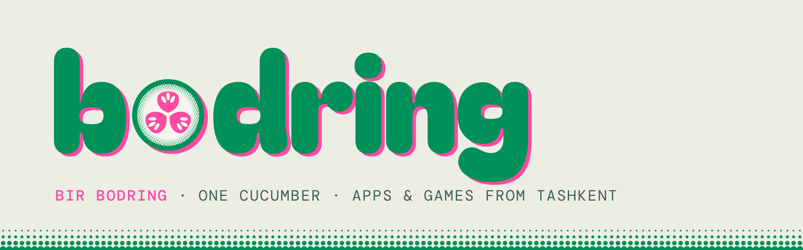

# The Bodring Company

We grow apps and games in small batches, one cucumber at a time, often in the open. *Bir bodring* means "one cucumber" in Uzbek.

## Live
- **[açiçuk](https://acicuk.uz)**: Uzbek tech news, short and sourced.
- **[açiçuk kombat](https://kombat.acicuk.uz)**: dishes fight 1v1 until one wins. That's lunch. Play it in Telegram at [@acicuk_bot](https://t.me/acicuk_bot).
- **[Bodring Skills](https://skills.bodr.ing)**: open skills for AI agents. YepNope finds what to build and OohNah how it should look.

## Building
- **[Mentol](https://mentol.io)**: a local-first home for your notes, tasks, people and time, kept as plain files you own.
- **Black Ledger**: a real-time strategy game fought across a city at night, district by district.
- **How to Hunt**: cooperative, absurd hunting with friends in Quiet Wood.
- **Bilbil**: a kids' encyclopedia app with an AI tutor.
- **Twitchers**: a deadpan old birdwatcher, a marsh at dawn and some very rude geese.

## Sticker jar
[Bodring stickers](https://t.me/addstickers/birbodring) and [Bodring emoji](https://t.me/addemoji/BodringEmoji) for Telegram.

---
[bodr.ing](https://bodr.ing) · [Instagram @birbodring](https://instagram.com/birbodring)
